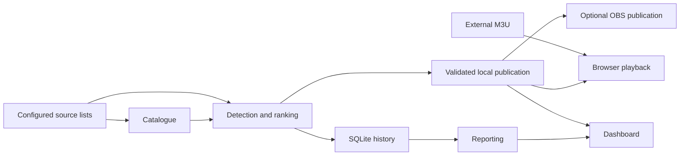

# Architecture and modules

[English](ARCHITECTURE.md) | [简体中文](ARCHITECTURE.zh-CN.md) · [Home](../README.md)

iptv-QA has five independently useful capabilities: catalogue discovery, quality checking, publication, reporting and browser playback. A workflow coordinates them when an end-to-end scheduled run is wanted. Playback can use an external M3U without running the checker; checking can produce local files without starting a player or enabling OBS.

## Module contracts

| Module | Input → output | Independent command | Runtime needs |
| --- | --- | --- | --- |
| Catalogue | Configured archives/lists → classified candidate lists and inventory | `catalog --config CONFIG` | Network; no FFmpeg |
| Detection | Configured lists → validated Top3/Top5, sets and run records | `check --config CONFIG` | FFmpeg + ffprobe; network |
| Publication | Existing validated export → configurable OBS objects | `publish --config CONFIG [--scope english]` | Optional OBS SDK and credentials only when enabled |
| Reporting | Local SQLite history → HTML, CSV and JSON | `report --data-dir DATA` | Local data; no media tools or source configuration |
| Playback | Local or remote M3U → authenticated browser playback | `play --port 8089` | Password; FFmpeg only for fallback transcoding |
| HTTP host | Published files/reports and optional playback → HTTP routes | `dashboard` / `serve` | Dashboard alone needs no player password |
| Workflow | Discovery → Chinese checking → English checking/publication | `run --config CONFIG` | Dependencies of enabled stages |

Commands are invoked as `python3 -m iptv_qa COMMAND ...`, or `iptv-qa COMMAND ...` after installation. Run each with `--help` for its own options. `check` retains the existing integrated export/report/optional-OBS behavior; `publish` also supports upload retries without repeating detection. The modules are separate Python boundaries and CLI entry points, rather than separate required network services.

## Dependencies and data flow



`common` owns shared parsing and I/O. Playback imports common playlist parsing, never the detector or OBS SDK. Reporting imports neither playback nor detection. The HTTP host loads playback only in modes that enable it. The OBS SDK is loaded only when an actual enabled upload is attempted. `workflows` is the orchestration layer; feature modules do not import it.

## Source layout

```
iptv_qa/
  cli.py                 # lazy command dispatcher
  common/                # playlist parsing, atomic I/O, locks
  catalog/               # discovery and language/radio classification
  detection/             # probing, decoding, observation, ranking
  publishing/            # optional OBS adapter and upload-only command
  reporting/             # SQLite history, HTML/CSV/JSON summaries
  playback/              # browser player service
    proxy.py             # upstream fetching and HLS rewriting
    state.py             # playlist registry and sessions
    transcoding.py       # owned FFmpeg process lifecycle
    service.py           # authenticated playback API
    assets/              # bundled frontend and hls.js license
  server/                # HTTP host; dashboard/player/combined modes
  workflows/             # full scheduled catalogue/check/publication run
config/                  # public configuration templates
systemd/                 # optional service/timer templates
scripts/                 # configuration, maintenance and validation tools
tests/                   # behavior and module-boundary regressions
```

Root `iptv_checker.py`, `daily.py`, `web.py`, `tv.py`, `quality.py`, `reporting.py` and `catalog_sources.py` remain compatibility shims. Existing launch commands and imports continue to reach the same implementation modules. New development belongs under `iptv_qa/`. Frontend assets now live inside the package so wheels include a usable player.

## Data ownership and operations

The configured data directory owns catalogue caches, runs, SQLite history, `published/current` and sanitized summaries; it is not part of the source package. English QA uses its own `english/` data subtree. Detection and maintenance coordinate through `run.lock`; catalogue/workflow coordination uses `pipeline.lock`. Standalone report/publish commands use the same locks as the checker. The player owns only its sessions, registry and temporary transcodes, not detection results. Shutdown stops its FFmpeg children and removes owned temporary files.

Use one combined HTTP service for a simple installation, or independent dashboard and player processes/ports for separate failure and resource boundaries. Both can read the same completed publication; neither needs to rerun QA. See [deployment](DEPLOYMENT.md), [playback](PLAYBACK.md), [detection rules](DESIGN.md) and [progress](../PROGRESS.md).

This refactor preserves QA policy and the existing player protocol. It does not imply deployment to an already running server. Full audio/video QA and receiver-specific success scoring remain roadmap work.
