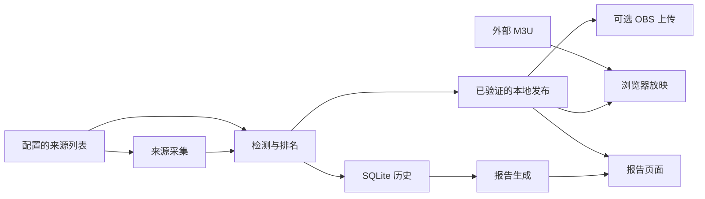

# 项目架构与模块

[简体中文](ARCHITECTURE.zh-CN.md) | [English](ARCHITECTURE.md) · [首页](../README.zh-CN.md)

iptv-QA 包含五项可独立使用的能力：来源采集、质量检测、订阅发布、结果报告、浏览器放映。工作流负责在需要时串起整轮任务。放映可以直接导入外部 M3U，不需要先运行检测；检测可以只生成本地文件，不必启动播放器或开启 OBS。

## 模块职责与运行方式

| 模块 | 输入 → 输出 | 独立命令 | 运行依赖 |
| --- | --- | --- | --- |
| 来源采集 | 配置的压缩包/列表 → 分类候选列表与来源统计 | `catalog --config CONFIG` | 网络，无需 FFmpeg |
| 质量检测 | 配置的源列表 → 已验证的 Top3/Top5、单源套表和记录 | `check --config CONFIG` | FFmpeg、ffprobe 和网络 |
| 订阅发布 | 现有已验证导出 → 可配置的 OBS 对象 | `publish --config CONFIG [--scope english]` | 启用上传时才需要 OBS SDK 和凭据 |
| 结果报告 | 本地 SQLite 历史 → HTML、CSV、JSON | `report --data-dir DATA` | 本地数据，无需媒体工具和源配置 |
| 浏览器放映 | 本地或远程 M3U → 密码保护的网页电视 | `play --port 8089` | 访问密码；转码回退时才需要 FFmpeg |
| HTTP 服务 | 已发布文件/报告及可选播放器 → HTTP 页面 | `dashboard` / `serve` | 纯报告模式无需播放器密码 |
| 整轮工作流 | 采集 → 中文检测 → 英文检测及发布 | `run --config CONFIG` | 已启用阶段所需依赖 |

完整写法为 `python3 -m iptv_qa 命令 ...`，安装后也可用 `iptv-qa 命令 ...`；每个命令都支持 `--help`。`check` 保留原来的导出、报告和可选 OBS 自动上传行为；`publish` 提供无需重新检测的上传重试入口。模块化体现为独立代码边界和运行入口，不要求把每个模块都部署成网络服务。

## 依赖与数据流



`common` 提供共享的列表解析和文件操作。放映直接复用共享解析，不导入检测引擎或 OBS SDK；报告不依赖放映或检测；HTTP 服务只在启用放映时加载播放器；OBS SDK 只在实际启用上传后加载。`workflows` 位于最上层协调任务，功能模块不反向依赖工作流。

## 目录布局

```
iptv_qa/
  cli.py                 # lazy command dispatcher
  common/                # playlist parsing, atomic I/O, locks
  catalog/               # discovery and language/radio classification
  detection/             # probing, decoding, observation, ranking
  publishing/            # optional OBS adapter and upload-only command
  reporting/             # SQLite history, HTML/CSV/JSON summaries
  library/               # 可选频道总表数据库、管理接口与后台
  playback/              # browser player service
    proxy.py             # upstream fetching and HLS rewriting
    state.py             # playlist registry and sessions
    transcoding.py       # owned FFmpeg process lifecycle
    service.py           # authenticated playback API
    assets/              # bundled frontend and hls.js license
  server/                # HTTP host; dashboard/player/combined modes
  workflows/             # full scheduled catalogue/check/publication run
config/                  # public configuration templates
systemd/                 # optional service/timer templates
scripts/                 # configuration, maintenance and validation tools
tests/                   # behavior and module-boundary regressions
```

根目录原来的 `iptv_checker.py`、`daily.py`、`web.py`、`tv.py`、`quality.py`、`reporting.py`、`catalog_sources.py` 保留为兼容入口，原启动方式和导入仍指向同一实现。后续功能代码放入 `iptv_qa/`。网页资源移入包内，安装 wheel 后也能完整提供播放器。

## 数据归属与部署边界

配置中的数据目录保存候选缓存、每轮记录、SQLite 历史、`published/current` 和脱敏报告，不混入源码。英语检测使用独立的 `english/` 子目录。检测与维护共享 `run.lock`，采集与整轮流程共享 `pipeline.lock`；独立报告和上传命令遵守同样的锁。播放器只管理会话、清单注册表及临时转码，不修改检测结果；关闭时清理自己启动的 FFmpeg 进程及临时文件。

简单部署可共用一个 HTTP 进程；也可把报告和放映拆成独立进程、端口与资源限制。二者读取完成后的发布文件即可，无需重跑检测。详见[部署](DEPLOYMENT.zh-CN.md)、[放映](PLAYBACK.zh-CN.md)、[检测规则](DESIGN.zh-CN.md)和[进度](../PROGRESS.md)。

本次整理保留检测策略和播放器接口，不代表已替换现有服务器程序。完整音画双检、按终端衡量播放成功率仍属于后续计划。

分层检测在 `detection/tiers.py` 中分开保存基础音视频证据与深检稳定性。选中 HLS 路径复用播放代理函数验证交付，不启动播放器 HTTP 服务；纯稳定清单是独立发布产物。

可选[频道总表](LIBRARY.zh-CN.md)统一管理受管播放和版本发布。管理接口复用播放器认证，独立后台负责OBS发布和私有加密备份；套表是派生输出，不再各自维护数据库。
