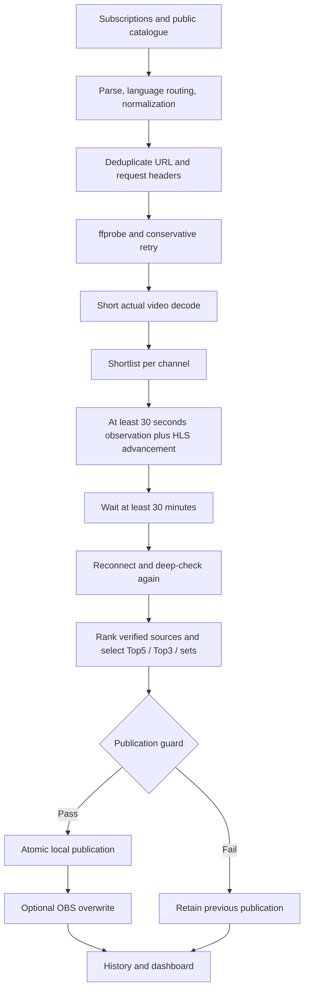

# Design

[English](DESIGN.md) | [简体中文](DESIGN.zh-CN.md) · [Home](../README.md)

This page covers the **quality-checking engine**. See [architecture](ARCHITECTURE.md) for module boundaries and [playback](PLAYBACK.md) for browser delivery/transcoding. The package refactor preserves the detection policy below.

## Goal

Select sources that produce usable television video from a specific network vantage point, rather than counting HTTP 200 responses or advertised HD labels. A passing source is evidence of recent server-side checks, not a promise about all receivers.

## Pipeline

`daily.py` owns catalogue synchronization, the Chinese run, and then the English run. `iptv_checker.py` can run independently against explicitly configured subscriptions. Discovery currently uses one configurable repository archive plus configurable public playlist URLs. It does not scrape arbitrary websites or scan address ranges.

## Identity and channel matching

The endpoint identity hashes the URL and supported request headers. Different required UAs can describe distinct usable requests. The normalized channel key merges naming/quality variants, but preserves CCTV 4K/8K, CCTV5+ and selected regional editions. This is heuristic aliasing, not visual channel recognition. Tested UA information is exported using `#EXTVLCOPT`, with provenance retained when export identities differ.

Language routing uses explicit tags, channel metadata, country and name heuristics. Other/unknown languages and NSFW entries are excluded by default. Country is not equivalent to language: the policy can misclassify multilingual channels and should be reviewed for other deployments.

## Playback tiers

Set `validation_policy` to `tiered-v1` (the example configuration uses this); omitted settings keep the legacy `strict-v1` behavior. Tiered mode requires video-quality and deep-validation settings enabled.

- **Basic playable:** this run decoded video and, independently, audio for `decode_seconds`. For HLS, `browser_proxy_check` also retrieves a selected manifest path, keys/init files and one segment using the browser proxy helpers and final redirect URLs. This checks delivery, not device codec support. Basic video decoding tolerates recoverable FFmpeg errors and uses the bounded `decode_timeout` budget for startup; deep thresholds remain unchanged.
- **Stable:** the same source additionally passed both deep connections and HLS freshness checks. Stable sources rank ahead of every fallback, including when host diversity would otherwise favor a fallback. `iptv_stable.m3u` contains only these sources, without the curated group.
- **Pending review:** current basic A/V checks passed but a deep/reconnect check failed. Preserve the basic evidence and the separate `stability_error`; keep the source as a lower-priority fallback and retry during the next scheduled run. A short-only candidate not selected for full verification is labelled `basic`, never `stable`. Historical success alone cannot qualify an endpoint. ENDLIST/VOD, missing video and failed audio/proxy checks are excluded.

Top3, Top5 and the three sets include basic/pending fallbacks after stable sources. Reports retain separate stable/basic/pending address counts; channel counts per tier may overlap when a channel has multiple sources. Pending/basic candidates do not receive a reliability failure merely for lacking two successful deep connections. Strict mode keeps the original two-pass publication gate.

## Validation stages

1. **Probe:** gather codec, actual dimensions, pixel format, frame-rate metadata and audio presence. Ignore attached album art as television video. Audio-only entries are rejected by the TV policy.
2. **Short decode:** decode approximately four seconds of video. Video-only output prevents audio timestamps from disguising absent video; passthrough frame timing avoids counting artificially duplicated frames.
3. **Deep shortlist:** first test up to ten candidates per channel. Continue through remaining candidates if fewer than five pass. Both video media time and wall-clock observation must reach the target.
4. **HLS freshness:** read the media playlist before and after observation, following a master playlist and redirects. Require a larger media sequence, or new segment URIs when sequence numbers are absent. Reject ENDLIST/VOD. This is a partial freshness check, not full HLS conformance validation or a check of every rendition.
5. **Reconnect:** after the first deep stage, wait until every surviving candidate is at least 30 minutes past its first completion, then open new connections. Fill failed slots from other first-pass survivors. In strict mode a first-pass-only source cannot enter a published playlist; tiered mode retains current basic evidence as a fallback.

Long HLS segment periods extend observation to at least two target durations plus two seconds. Normal gaps between segment downloads are not considered stalls while decoded video still covers estimated playout. A lag-based heuristic flags substantial delivery shortfall. These buffer and stall estimates do not represent actual Apple TV player logs.

| Setting | Default | Meaning |
| --- | ---: | --- |
| `decode_seconds` | 4 | Initial decoded video duration |
| `deep_seconds` | 30 | Minimum media and wall observation for each deep connection |
| `fast_startup_seconds` | 5 | Preferred startup category |
| `max_startup_seconds` | 30 | Wait limit for the first sampled video frames |
| `max_stall_seconds` | 8 | Additional lack of progress after estimated buffer exhaustion |
| `recheck_interval_seconds` | 1800 | Minimum gap before independent reconnection |

These values are project heuristics, not thresholds mandated by Apple or HLS standards. The startup wait limit separates playable sources from dead ones; within that budget, startup speed is a ranking preference (`fast_startup_seconds`), not a pass/fail criterion.

## Ranking and resource control

Ordering is: stable tier first; fast startup category; no retries; exponentially weighted historical reliability; two-second startup bucket; resolution capped at 1080p for ranking; total test time; deterministic identity. A 4K source is retained but does not automatically outrank a responsive 1080p source. Different hostnames are preferred for backups, although hostnames do not prove physical-server independence.

Historical reliability uses `new = 0.75 * old + 0.25 * current_success`. Samples do not update it. Sources excluded only because they did not receive a complete deep test are not recorded as failures. Sample count is stored but does not yet contribute confidence bounds to ranking.

Global and per-host concurrency are separate. Workers are submitted only when the host has capacity, so one slow host does not occupy every worker with semaphore waits. Previous published URLs receive scheduling priority, but publication still waits for the completed run. Defaults: probe 32 / per host 3; decode 6 / per host 2; deep checks 6 / per host 1. More concurrency can reduce reliability because of server limits and shared bandwidth; CPU saturation is not the optimization target.

## Publication, history and object storage

Local files share one versioned export directory and switch through a `published/current` symlink. Zero usable channels, a channel drop below the configured ratio, or a source shrink below that ratio blocks publication. Tiered publications compare channel totals only with the same validation policy. On the first migration, incompatible legacy channel counts are explicitly not compared; zero-result and source-size guards remain, and subsequent runs use the new policy baseline. Reports record this migration decision. Legacy strict migration still uses recorded video evidence to remove radio from its old baseline.

OBS is an independent optional adapter. Fixed keys preserve subscription URLs. SDK failures retry; failed uploads retain local results for `--upload-only`. Uploading multiple OBS objects is sequential, not atomic, and never changes bucket ACLs. Chinese and English runs have separate publication directories. Only sanitized summaries are public; detailed JSONL can contain URLs and tokens and stays private.

An optional curated `international_news` playlist is appended under one group title (default `International News`) to Top3 and the three sets, including the English Top3, but never to Top5. These entries bypass QA validation and are the operator's responsibility; a missing or unreadable file only logs a warning, and publication continues without the group.

## Known limitations

- Deep checks observe video. Tiered basic checks separately decode audio; silence, A/V drift and full receiver codec compatibility are not validated.
- First-frame timing is an FFmpeg progress sample upper bound, not visible receiver startup.
- Encoded black frames, static pictures and wrong-channel content can pass. There is no OCR or visual content classifier.
- Two short nighttime observations cannot establish peak-hour stability, long token lifetime, or multi-day uptime.
- HLS media-sequence comparison is partial; independent audio, rendition alignment, discontinuities, keyframe access and all encryption/initialization combinations are not fully checked.
- Deep and legacy strict checks use `-xerror` and can reject streams tolerant players recover from; tiered basic checks omit it. Fixed thresholds require calibration using receiver successes and failures.
- A server check cannot reproduce the household network route or a third-party player's handling of `#EXTVLCOPT` headers.

The next priorities are full audio/video quality analysis, actual rendition matching, longer tests for frequently watched Top1 channels, black/freeze flags, and receiver-calibrated measurements. These are planned, not released features.

## References

- [RFC 8216: HTTP Live Streaming](https://www.rfc-editor.org/rfc/rfc8216.html)
- [Apple HLS authoring requirements](https://developer.apple.com/streaming/hls-authoring-specification-for-apple-devices.html)
- [FFmpeg command-line documentation](https://ffmpeg.org/ffmpeg.html)
- [Apple playback access logs](https://developer.apple.com/documentation/avfoundation/avplayeritemaccesslogevent)

## Managed publication

When channel-library integration is enabled, only successful complete QA results update library eligibility; manual disables/quarantines remain intact. Media observations are retained separately from browser feedback. Publication then derives all managed views from a consistent database snapshot. See [library design](LIBRARY.md).
