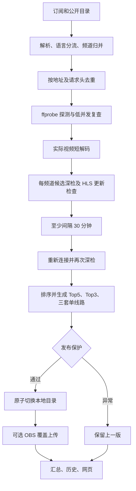

# 设计思路

[English](DESIGN.md) | [简体中文](DESIGN.zh-CN.md) · [首页](../README.zh-CN.md)

本页专门描述**质量检测引擎**。整体模块关系见[项目架构](ARCHITECTURE.zh-CN.md)，浏览器播放和转码见[放映指南](PLAYBACK.zh-CN.md)。目录重构不改变以下检测策略。

## 目标和流程

从特定网络观察点筛出真正能输出电视画面的地址，而非只判断 HTTP 200 或名称中是否带“高清”。通过结果反映检测时的网络环境，不能保证适用于其他网络和所有接收设备。

`daily.py` 管理目录同步、中文检测和后续英文检测；`iptv_checker.py` 可以独立处理指定订阅。发现机制目前是一个可配置的仓库归档和若干公开列表，不会扫描 IP 地址段或任意网站。

## 去重、频道和语言

地址与支持的请求头共同组成检测身份。不同 UA 可能对应不同的有效请求。频道名称归一化会合并命名和画质后缀，但保留 CCTV 4K/8K、CCTV5+ 和部分地区版本。它不是通过画面确认频道的算法。

成功检测时使用的 UA 会通过 `#EXTVLCOPT` 写回订阅，并保留原始来源贡献。语言依赖明确标签、频道资料、国家和名称推断；国家并不等于语言，多语言频道可能误分，需要按使用场景调整。

## 可播与稳定分层

配置 `validation_policy: "tiered-v1"` 启用分层（示例配置已启用）；未设置时保留原 `strict-v1` 行为。分层要求同时启用视频质量检查和深检。

- **基础可播**：本轮视频和音频分别实际解码达到 `decode_seconds`。HLS 默认还用网页代理同一套函数按跳转后地址读取选中路径、密钥、初始化文件和一个分片；验证的是交付链路，不代表所有设备编码兼容。基础视频检查允许 FFmpeg 可恢复错误，起播使用有界的 `decode_timeout` 预算；深检阈值不变。
- **稳定优选**：基础检查通过，再通过两次深检及 HLS 新鲜度检查；始终排在所有备用之前，主机分散规则不会让备用挤掉稳定源。独立 `iptv_stable.m3u` 只包含稳定源，不追加人工精选组。
- **待复查**：本轮基础音视频检查通过，但深检或间隔复检失败。保留基础证据及独立的 `stability_error`，降级为备用，在下一次定时检测重试。短检通过但未被选中完成深检的源标为 `basic`，不能标为稳定。只靠历史成功不能入选；已结束/点播清单、无视频以及音频或代理检查失败仍排除。

Top3、Top5、三套订阅均按稳定优先，再保留基础/待复查备用。报告分别记录三类地址数；同一频道可能有不同等级线路，因此分层频道数可重叠。基础或待复查源不会仅因未通过两次深检被记入历史可靠性失败。严格模式保留原两次验证发布门槛。

## 检测层次

1. **探测媒体信息**：读取视频编码、实际宽高、像素格式、帧率和音频存在情况。封面图不算电视画面；纯音频不进入电视订阅。
2. **约四秒短检**：单独解码视频，防止音频时间戳掩盖缺失视频；禁止补帧计数掩盖问题。
3. **候选深检**：每频道先测最多十个候选，不足五个通过时继续检查剩余候选。实际观察时间和视频时间都必须达标。
4. **HLS 新鲜度**：深检前后读取媒体列表，跟随主列表和重定向；有媒体序号时要求序号增大，没有序号时检查新分片地址。ENDLIST/点播不通过。这是部分新鲜度检查，不是完整 HLS 标准验证，也没有检查所有清晰度和独立音轨。
5. **间隔复检**：首次深检结束后，确保所有待复检源距首次完成至少三十分钟，再使用新连接检测。失败后从首次通过的替补补位；严格模式下只通过一次的源不能发布；分层模式可依据本轮基础证据降级保留。

HLS 分片较长时，观察窗口延长至至少两个分片周期加两秒。已有解码视频仍足以覆盖播放时，分片下载间隔不会被误当成卡顿；明显跟不上播放速度时再标记供给不足。这些是服务器侧缓冲估计，不是 Apple TV 的实际卡顿日志。

| 参数 | 默认值 | 含义 |
| --- | ---: | --- |
| `decode_seconds` | 4 | 初筛视频时长 |
| `deep_seconds` | 30 | 每次深检的最低观察及视频时长 |
| `fast_startup_seconds` | 5 | 优先起播类别 |
| `max_startup_seconds` | 30 | 等待首批视频帧上限 |
| `max_stall_seconds` | 8 | 估计缓冲耗尽后额外等待上限 |
| `recheck_interval_seconds` | 1800 | 两次连接的最小间隔 |

这些是项目经验值，不是 Apple 或 HLS 规定的统一阈值。起播等待上限只用于区分能播与死流；预算之内起播快慢只影响排序优先级（`fast_startup_seconds`），不单独决定成败。

## 排序与资源

排序依次考虑：稳定等级、起播快类别、无需重试、历史可靠性、两秒起播耗时档位、分辨率（排序按 1080p 封顶）、总耗时和确定性身份。保留 4K，但不让它仅因清晰度就压过响应快的 1080p。备用优先不同主机名，但不同域名仍可能属于同一服务器。

历史可靠性更新为 `新值 = 0.75 × 旧值 + 0.25 × 本次成功与否`。小样本诊断不更新；只是没参加完整深检的候选不记为失败。目前存储了历史次数，但排序尚未使用样本数量计算置信度。

并发分为全局和单主机两层，只提交有连接名额的服务器任务。旧版已发布地址优先调度，但仍等全轮完成后发布。默认探测 32、单主机 3；解码 6、单主机 2；深检 6、单主机 1。高并发可能触发上游限流或争抢带宽，CPU 占满不是优化目标。

## 发布、历史和 OBS

本地结果保存在版本目录，通过 `published/current` 符号链接统一切换。零可用、频道数或输入来源记录数低于保护比例时，保留上一版。分层发布只比较相同检测策略的频道数；首次迁移不将旧策略数量作直接对比，报告明确记录，零结果和输入来源缩水保护仍保留，后续轮次恢复同策略频道数保护。旧严格模式的视频迁移仍可用历史视频证据扣除广播基线。

OBS 为独立可选模块：固定对象名维持订阅地址，失败重试，支持 `--upload-only`。多个对象逐一上传，并非原子事务；不修改桶权限。中英文拥有不同发布目录。公开汇总不带原始播放地址；JSONL 明细可能含令牌，必须留在私有目录。

可选的 `international_news` 精选播放列表会以统一分组名（默认 `International News`）附加到 Top3 与三套，英文 Top3 同样适用，但绝不进入 Top5。这些条目不经过质检，由运维者自行负责；文件缺失或不可读时仅记录告警，其余内容照常发布。

## 现有边界

- 深检观察视频；分层基础检查另行实际解码音频，但尚未检查静音、音画同步及完整终端兼容性。
- 起播是 FFmpeg 进度采样上界估计，不是接收设备可见画面的时间。
- 正常编码的黑屏、静止图、占位节目或错误频道可能通过；没有 OCR 和画面内容识别。
- 夜间两次短测不能证明高峰期表现、令牌有效期和多天连续稳定。
- HLS 未完整验证独立音轨、各清晰度对齐、时间戳断点、关键帧和全部加密/初始化组合。
- 深检和旧严格检查的 `-xerror` 可能淘汰播放器能容错恢复的源；分层基础检查不使用该参数；固定阈值需要实播样本校准。
- ECS 不能代表家庭网络路径，也不能保证第三方 App 读取 `#EXTVLCOPT`。

下一步优先完整音画质量检查、匹配实际播放分支、常看 Top1 长测、黑屏/冻结标记及终端对照。这些均为计划能力。

## 参考资料

[HLS 标准](https://www.rfc-editor.org/rfc/rfc8216.html) · [Apple HLS 要求](https://developer.apple.com/streaming/hls-authoring-specification-for-apple-devices.html) · [FFmpeg](https://ffmpeg.org/ffmpeg.html) · [Apple 播放日志](https://developer.apple.com/documentation/avfoundation/avplayeritemaccesslogevent)

## 受管发布

启用总表后，仅完整合格QA结果更新自动可用资格，人工停用和清理标记保留。媒体观察与浏览器反馈分开保存，受管输出统一从一致的数据库快照派生，详见[总表设计](LIBRARY.zh-CN.md)。
