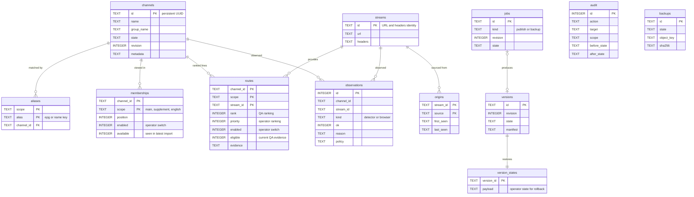
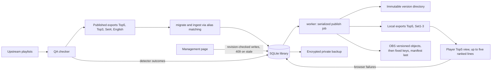

# Channel library and management

[English](LIBRARY.md) | [简体中文](LIBRARY.zh-CN.md) · [Home](../README.md)

The optional channel library is the source of truth for managed playback and publication. Enable `channel_library.enabled`, set a shared `path` and `data_root`, and pass the private config to the web service using `--library-config` or `IPTV_LIBRARY_CONFIG`. Open `/tv/manage/` and log in with the player password. Custom remote playlists remain read-only inputs.

Channels use persistent UUIDs; aliases and exact request identities assist import matching. Metadata IDs are scoped and conflicting names are not blindly merged. A channel may belong to main, supplemental and English views. Each membership and line has independent operator controls; current QA eligibility is separate from manual enabled state. Reimport never resets manual removals or disabled lines. Ambiguous matching still needs operator review.

The manager supports search, pagination, name/group edits, line priority, line disable/restore, scoped channel quarantine/restore, impact preview, publication jobs, version rollback and encrypted-backup requests. Changes use revision checks; stale pages receive HTTP409. Detector results and browser failures are separate observations. Detailed raw URLs and credentials are not returned by the management list API.

The player shows one row per channel and tries up to five ranked lines. Main reads the library Top5 view; Set1–3 and Top3 remain compatibility exports. The homepage exposes playback and management, and collapses history/compatibility links; there is no prominent Top5 subscription button. Current library totals are distinct from the latest QA run, which may have been blocked from publication.

Failure cleanup (失效清理) is opt-in and defaults off. A managed channel receives one 20-second startup budget across all lines. Exhausting the lines or budget quarantines the channel in the current view and queues publication. Actual playback, autoplay denial and manual/source switches cancel the startup timer. Login failure and offline state do not delete records. Quarantine is reversible from the management page; raw sources are not edited. A custom subscription cannot trigger managed deletion.

## Data model

The library is one SQLite database. Identity, operator intent and machine observations live in separate tables and columns so that imports, QA runs and human edits never overwrite each other.



- `channels` — one row per channel with a persistent UUID. The UUID survives renames, group moves and re-imports.
- `aliases` — scoped matching keys (`epg:tvg-id:...` when available, otherwise the name). Aliases only assist import matching; a rename never breaks identity, and conflicting names are not blindly merged.
- `memberships` — which views (main, supplemental, English) a channel belongs to, with an operator switch (`enabled`) separate from latest-import availability (`available`). Views are labels on rows, not separate table sets, so adding a fourth scope needs no schema change.
- `routes` — one row per channel, view and line: QA rank, operator priority, operator switch, current QA eligibility and evidence. Manual and automatic state are different columns, so imports and QA runs cannot reset operator decisions.
- `streams` / `origins` — a line's URL and headers are stored once and shared across channels and views; origins record which source first and last supplied each line.
- `observations` — append-only detector and browser evidence. Observations never mutate channel state directly; eligibility is derived from them separately.
- `audit` — append-only record of every operator action with before/after state.
- `jobs` / `versions` / `version_states` — publication and backup jobs carry the database revision they were queued against; each publication is an immutable version plus a rollback payload of operator state.
- `backups` — one row per encrypted snapshot with state and checksum; a failed upload never becomes a verified backup.

## Data flow



Imports refresh machine state only; operator actions are the only writers of operator state; the worker is the only publisher. A queued publish is superseded when the database revision moves past the revision the job was queued against.

## Design choices and trade-offs

1. **SQLite as the single source of truth.** One file to back up, no extra service, and the write load (one operator, one worker) fits a single writer. Rejected alternative: a client-server database, which would add an operator-managed service without solving a problem this deployment has. Cost: concurrent multi-host writes are unsupported; connections are short and use `BEGIN IMMEDIATE` with a busy timeout instead of long locks.
2. **Persistent UUIDs with alias-based matching.** Names change; identity must not. Aliases are scoped and only assist matching, so a rename or group move never creates a duplicate channel. Trade-off: ambiguous matches (same name, different request identity) are left for operator review instead of being merged automatically.
3. **Operator state and machine state in separate columns.** `enabled` and `priority` are never reset by imports or QA runs; `eligible`, `available` and `rank` are refreshed by automation. This prevents an automated run from silently undoing a manual removal. Cost: more states to reason about, which the management UI exposes explicitly.
4. **Per-view membership and quarantine.** The same channel can be enabled in one view and quarantined in another; quarantine is reversible per view and never edits raw sources. Trade-off: more rows than a global flag, accepted so cleanup in one view cannot damage the others.
5. **Revision-based optimistic concurrency.** Every write bumps a global revision; management requests carry the revision they read, and stale pages receive HTTP 409 instead of overwriting newer edits. Chosen over locking because operator pages are long-lived. Cost: operators must reload after a conflict.
6. **Immutable publication versions, serialized publisher.** Each publication writes a new immutable version; rollback restores operator state from a version and creates a new publication rather than mutating history. OBS multi-object updates are not atomic, so versioned objects upload first, fixed keys second and the sanitized manifest last; a partial failure retries the same version. Trade-off: a brief window where fixed keys lag one version, accepted instead of distributed-transaction complexity.
7. **Observations separate from eligibility.** Detector and browser evidence is append-only and eligibility is derived, so "the checker saw one failure" and "the channel is removed" remain different facts. A failed or sample run cannot replace the library.
8. **A backup counts only after verification.** Every snapshot is restored locally before upload, the object is private-ACL, anonymous access is tested to be denied, and bytes are re-downloaded and checked. Trade-off: slower backups; never a verified backup without evidence.
9. **Pragmatic SQLite settings.** WAL mode is not enabled: with short-lived connections and a single-writer load, the default journal mode's reader/writer locking cost stays small; enabling WAL is a future improvement if concurrent access grows. Foreign keys are enforced only on `aliases`; channels are never hard-deleted, so no orphan rows can appear today, and a future hard-delete path would have to clean up routes, memberships and observations explicitly.

## Migration and publication

```bash
python3 -m iptv_qa library migrate --config /etc/iptv-qa/config.json
python3 -m iptv_qa library publish --config /etc/iptv-qa/config.json
python3 -m iptv_qa library worker --config /etc/iptv-qa/config.json
```

First migrate and test in an isolated directory, preserving current playlists. Migration imports existing main Top5/Top3, supplemental Set4 and English exports without claiming new media verification. An approved future QA result updates library eligibility; an in-flight pre-migration successful run can be reconciled by the worker. Failed/sample runs cannot replace the library.

Publication uses an immutable directory per revision and one serialized publisher. Local playlist pointers switch to generated exports; OBS versioned files upload before their fixed-key counterparts, and a sanitized manifest is uploaded last. Multi-object OBS updates are not atomic: partial delivery remains marked failed and retries the same immutable version. A queued publish is superseded if the database changes before processing; it cannot silently publish unreviewed later edits. Rollback restores operator control state from a known version and creates a new publication; it never erases the audit trail or revives a line lacking current eligibility.

## Private backup and recovery

Install the optional backup dependency (`cryptography`) in the worker environment. Configure `channel_library.backup` with `enabled`, a dedicated private `bucket`, `prefix` and `key_path`. Keep credentials in the service environment, never in source. The worker needs the OBS SDK; the web application only writes the library database and does not need bucket credentials.

SQLite backup API (or a transaction-consistent SQL snapshot on legacy Python) produces the database snapshot. A manifest and redacted config are packaged and authenticated-encrypted with Fernet; the encryption key is never packaged. Every backup is restored locally for integrity validation before upload. The object is uploaded with private ACL, checked for public-group grants, tested for anonymous denial, and downloaded again for byte verification. A failure never appears as a verified backup. The worker schedules daily backups and retains versioned history; retention/lifecycle deletion should be configured separately in the private bucket.

```bash
python3 -m iptv_qa library backup --config /etc/iptv-qa/config.json
python3 -m iptv_qa library restore --config /etc/iptv-qa/config.json \
  --snapshot PRIVATE_BACKUP.fernet --destination NEW_RECOVERY_DIRECTORY/catalog.sqlite3
```

Restore only writes a new destination and verifies authentication, checksum, schema and SQLite integrity. Activating a restored database requires stopping writers first; retain the previous database and configuration for rollback. Keep an independent copy of the encryption key: a backup alone is insufficient after total host loss. Backups and databases must never be hosted by the public HTTP service or committed to Git.
