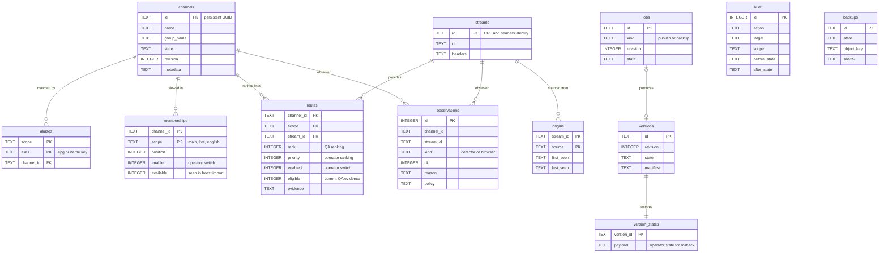
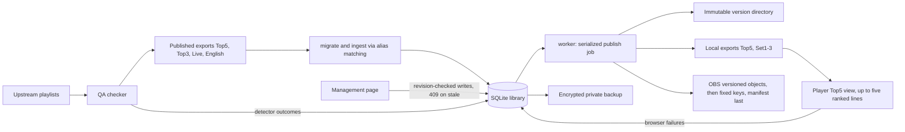

# 频道总表与管理

[简体中文](LIBRARY.zh-CN.md) | [English](LIBRARY.md) · [首页](../README.zh-CN.md)

可选频道总表是受管播放和发布的唯一数据来源。启用 `channel_library.enabled`，指定共享 `path`、`data_root`，通过 `--library-config` 或 `IPTV_LIBRARY_CONFIG` 将私有配置传给网页服务。在 `/tv/manage/` 使用播放器密码登录。自定义远程订阅仍为只读输入。

频道使用持久 UUID；别名和完整请求身份辅助匹配。元数据ID按分组建立映射，名称冲突时不盲目合并。同一频道可属于综合、直播、英语多个视图。分组成员和线路各自保留人工启停状态，自动检测可用资格与人工控制分开，再导入不会覆盖清理或停用标记。模糊匹配仍需人工检查。

管理页支持搜索分页、名称和分组修改、线路优先级、线路停用恢复、按分组清理恢复、影响预览、发布任务、版本回退及加密备份请求。写操作带版本检查，旧页面收到409而不是覆盖新数据。服务端检测和浏览器失败分开记录。列表API不返回原始源URL或凭据。

播放器每台显示一行，按优先级最多尝试五条线路；综合入口读取总表Top5视图，Set1–3和Top3保留为兼容输出。首页突出播放和管理，历史及兼容文件折叠，不再突出Top5订阅按钮。当前总表数量与最近一轮检测分开，发布被拦截的检测不会冒充正在提供的全部频道。

失效清理默认关闭，仅对受管分组有效。每台五条候选共享20秒起播预算，线路全部失败或预算耗尽时移入当前分组清理区，并排队发布；实际播放成功、自动播放被浏览器拒绝、手动切台或换分组时取消起播清理计时。登录失效或整体断网不触发清理。可在管理页恢复，不修改原始采集来源，自定义订阅不能触发总表清理。

另有播放器**报错清理**按钮，供观众上报画面内容与频道不符的线路：`report_line` 以 `content_mismatch` 为由只禁用该条线路（`disable_line`），留审计与浏览器观察记录并排队异步发布；上报把该台线路耗尽时再追加频道级隔离。这类人工禁用属于操作员状态，QA 轮次不会自动恢复，恢复需在管理页操作。

## 数据模型

总表是一个 SQLite 数据库。频道身份、人工操作和机器观测分别放在不同的表和列里，导入、检测和人工修改互不覆盖。



- `channels` — 每台频道一行，持久 UUID。改名、换分组、重新导入都不会改变 UUID。
- `aliases` — 按视图隔离的匹配键（有 `tvg-id` 时用 `epg:tvg-id:...`，否则用名称）。别名只辅助导入匹配；改名不会破坏身份，名称冲突也不会被盲目合并。
- `memberships` — 频道属于哪些视图（综合、直播、英语），人工开关（`enabled`）与最近一次导入是否见到（`available`）分开。视图是行上的标签而不是独立的表，加第四个范围不需要改表结构。
- `routes` — 每台频道、每个视图、每条线路一行：检测排序（`rank`）、人工优先级（`priority`）、人工开关（`enabled`）、当前检测资格（`eligible`）和证据。人工状态与自动状态是不同的列，导入和检测不会重置人工决定。
- `streams` / `origins` — 线路的 URL 和请求头只存一份，跨频道、跨视图共享；origins 记录每个线路最早和最近由哪个来源提供。
- `observations` — 只追加的检测器和浏览器证据。观测不直接改频道状态，资格是从观测中另行推导的。
- `audit` — 只追加的人工操作记录，含操作前后的状态。
- `jobs` / `versions` / `version_states` — 发布和备份任务带着排队时的数据库修订号；每次发布是一个不可变版本，外加一份可回退的人工状态快照。
- `backups` — 每份加密快照一行，含状态和校验和；上传失败永远不会显示成已验证的备份。

## 数据流



导入只刷新机器状态；人工操作是人工状态的唯一写入者；后台是唯一的发布者。排队发布之后数据库修订号又前移时，旧发布请求作废。

## 设计取舍

1. **SQLite 作为唯一数据来源。** 一个文件即可备份，不需要额外服务，写入压力（一个管理页、一个后台）单写入者足够。放弃的方案：客户端-服务器数据库，会多出一个需要运维的服务，却解决不了当前部署实际遇到的问题。代价：不支持多机并发写入；连接保持短事务，用 `BEGIN IMMEDIATE` 加忙等待超时，不用长锁。
2. **持久 UUID 加别名匹配。** 名称会变，身份不能变。别名按视图隔离、只做辅助，改名或换分组不会产生重复频道。取舍：模糊匹配（同名但请求身份不同）留给人工复核，不做自动合并。
3. **人工状态与机器状态分列。** `enabled`、`priority` 不会被导入或检测重置；`eligible`、`available`、`rank` 由自动化刷新。这保证自动运行不会悄悄撤销人工删除。代价：需要理解的状态更多，管理页把这些状态明确展示出来。
4. **按视图的成员关系和清理区。** 同一台频道可以在一个视图启用、在另一个视图被隔离；清理按视图可逆，不改原始来源。取舍：行数比一个全局开关多，换来的是单视图清理不会波及其他视图。
5. **基于修订号的乐观并发。** 每次写入都递增全局修订号；管理请求带着它读到的修订号，过期页面收到 HTTP 409 而不是覆盖新编辑。选它而不是加锁，是因为管理页面停留时间长。代价：冲突后需要重新加载。
6. **不可变发布版本、串行发布器。** 每次发布写一个新版本；回退是从版本恢复人工状态再生成新发布，而不是改写历史。OBS 多对象更新不是原子的，所以先传版本化对象、再传固定键、最后传脱敏清单；部分失败重试同一版本。取舍：固定键短暂落后一个版本，用这个窗口换取不引入分布式事务的复杂度。
7. **观测与资格分离。** 检测器和浏览器证据只追加，资格另行推导，"检测器看到一次失败"和"频道被移除"始终是两件事。失败或样本运行不能替换总表。
8. **备份先验证再算数。** 每份快照上传前先在本地实际恢复，对象设为私有 ACL，实测匿名访问被拒，再回下载核对字节。取舍：备份更慢；没有证据就永远不会有"已验证"的备份。
9. **务实的 SQLite 设置。** 未启用 WAL 模式：连接短存活、单写入者负载下，默认日志模式的读写互锁代价很小；并发增长后启用 WAL 是后续改进项。外键只在 `aliases` 上强制：频道从不硬删除，当前不会出现孤儿行；将来若引入硬删除路径，需显式清理 routes、memberships 和 observations。

## 迁移和发布

```bash
python3 -m iptv_qa library migrate --config /etc/iptv-qa/config.json
python3 -m iptv_qa library publish --config /etc/iptv-qa/config.json
python3 -m iptv_qa library worker --config /etc/iptv-qa/config.json
```

先在隔离目录迁移验证并保留当前订阅。迁移读取已有主表Top5/Top3、直播和英语输出，不把导入称作重新媒体验证。后续合格QA结果更新总表资格；迁移前仍在运行的旧任务若成功发布，后台可接入，失败和诊断样本不能替换总表。

每次发布生成不可变版本目录，单个发布器串行执行。先生成本地输出，OBS先写版本化对象再写固定对象，脱敏完成清单最后上传。OBS多对象更新不是原子事务，部分成功会保留失败状态并重试同一版本。排队期间总表改变则旧发布请求作废，不能悄悄发布未经复核的后续编辑。回退恢复所选版本的人工控制状态，再生成新发布，不抹掉操作记录，也不会恢复缺少当前检测资格的线路。

## 私有备份与恢复

在后台服务环境安装可选加密依赖 `cryptography`；配置 `channel_library.backup` 的 `enabled`、独立私有 `bucket`、`prefix` 和 `key_path`。凭据放服务环境，不进源码。后台需要OBS SDK；网页只写数据库，不需要桶密钥。

通过SQLite备份接口（旧Python使用事务一致的SQL快照）生成数据库快照，配合校验清单和去密钥配置，用Fernet认证加密；解密密钥不打包。上传前每份备份先实际恢复验证；对象明确设为私有，再检查公开组授权、验证匿名不能读取、认证下载核对字节。失败不能显示成已验证。后台每日生成版本化备份；保留期限和清理生命周期另在私有桶配置。

```bash
python3 -m iptv_qa library backup --config /etc/iptv-qa/config.json
python3 -m iptv_qa library restore --config /etc/iptv-qa/config.json \
  --snapshot PRIVATE_BACKUP.fernet --destination NEW_RECOVERY_DIRECTORY/catalog.sqlite3
```

恢复仅写入不存在的新目标，验证认证、哈希、结构版本和数据库完整性。切换恢复后的总表前须停止写入者，并保留原数据库及配置供回退。解密密钥另存一份，否则ECS完全损坏后只有备份也无法恢复。数据库和备份均不能通过公开HTTP托管或提交Git。
