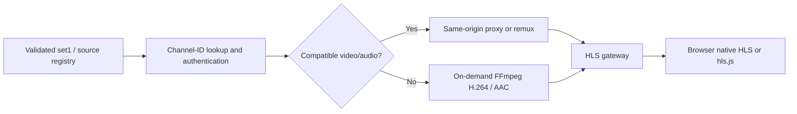

> Historical research: this records the pre-implementation proposal, not current capability. The player is implemented; see [playback](PLAYBACK.md) and [architecture](ARCHITECTURE.md). Earlier research-only restrictions below are superseded.

# Browser TV feasibility — research only

[English](WEB_PLAYER_FEASIBILITY.md) | [简体中文](WEB_PLAYER_FEASIBILITY.zh-CN.md) · [Progress](../PROGRESS.md)

## Requested outcome

Import the validated set1 playlist, provide large previous/next/random buttons and a channel list, and make playback available from a mobile or in-car passenger browser on the existing host and port. **No player implementation or deployment is included in this release.** The existing dashboard remains a QA dashboard.

## Assessment

Feasible for reachable, usable public HTTP/HLS streams. Putting authenticated media delivery on the ECS can avoid browser CORS issues and normalize some codec/container combinations, but it cannot make an unreachable, expired, damaged or encrypted source usable. Server transcoding also cannot guarantee every old in-car browser supports the resulting playback stack.

Prefer **proxy → remux → transcode only when needed**, rather than re-encoding every channel:

Run only active channels. Share an output when clients watch the same channel, stop idle workers, bound concurrency and segment retention, and give playback priority over batch QA. Benchmark CPU/GPU capacity for the intended deployment; do not assume hardware acceleration or multi-stream realtime 4K transcoding is available.

## Reuse candidates reviewed on 2026-11-16

| Project | Verified scope | Fit / caveat |
| --- | --- | --- |
| [hls.js](https://github.com/video-dev/hls.js) | HLS client using HTML video and browser media support | Small custom UI; it is not a server transcoder or a universal codec decoder |
| [IPTVnator](https://github.com/4gray/iptvnator) | Desktop/browser IPTV player and self-hosted backend | Good playlist/navigation reference; browser codec limits still apply |
| [neTV](https://github.com/jvdillon/netv) | Server/gateway, passthrough/remux and GPU-oriented transcoding | Candidate for a fuller system; GPU dependencies and CPU fallback need specific evaluation |
| [CodingButter/webtv](https://github.com/CodingButter/webtv) | Cross-platform HLS player, EPG/DVR and proxy features | Its README does not establish the universal automatic codec-transcoding behavior claimed in the supplied proposal |

“WebTV” is not a unique project name. A specific repository, Docker image, license and version must be selected before relying on its features. The proposed solution should not be considered verified just because an app has this name.

## Existing host and port

Keep the public endpoint but separate the media gateway from the read-only QA process. A future reverse proxy on the existing public port can route `/` to the dashboard, `/tv` to the player and `/media/` to a localhost streaming service. Existing 80/443 services need not be replaced. Changing the current HTTP endpoint to HTTPS changes the URL scheme and requires a certificate trusted by the target browsers; a domain is usually easier to manage than assuming IP-certificate support.

Authentication must cover manifests, segments and any key/initialization requests, not just the HTML page. The gateway should accept validated channel IDs, not arbitrary user-supplied proxy URLs. M3U parsing and media requests must preserve applicable UA/Referer information without publishing credentials into a third-party CORS service. HLS manifests may require nested URL rewriting, including encryption keys, init maps, variants, audio and subtitle renditions.

UDP multicast needs an accessible upstream network/relay; a public ECS does not join an unrelated operator's private multicast network. No such relay is implemented here.

## Playback UX and validation

- Previous/next cycle through available TV channels; random excludes radio and preferably avoids immediate repetition.
- Include explicit play/retry, source-error feedback and fullscreen/landscape controls. Autoplay with audio depends on browser user-gesture policy.
- On source failure, an optional future fallback can consult Top3/Top5 rather than silently displaying a broken channel.
- Measure channel-change delay, startup, stalls, audio/video sync, CPU and peak transfer rate on the actual phone/in-car browser.
- At 2–4 Mb/s, one hour is approximately 0.9–1.8 GB of media transfer per viewer, before overhead. This is a bandwidth calculation, not a hosting-cost estimate.

Recommended first prototype scope, if later authorized: one active viewer, 720p/1080p H.264 + AAC output, authenticated same-origin HLS, set1 navigation and random play, with CPU/latency measurements. Do not start by transcoding every channel or deploying an unrelated large media stack.
